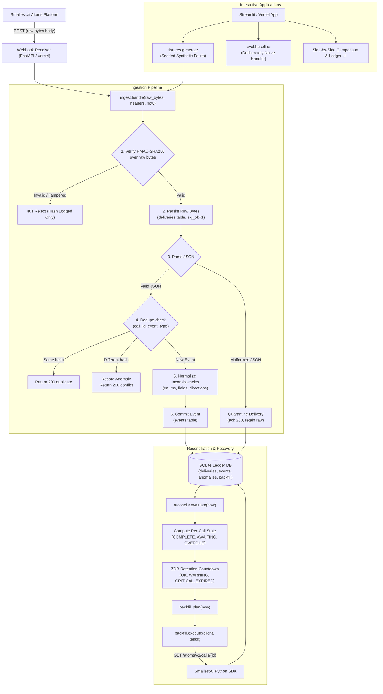

# System Architecture

---

## 1. Architectural Components

### 1.1 Webhook Receiver (`receiver/app.py` & `api/index.py`)
A lightweight, stateless ASGI service implemented in FastAPI. Its sole responsibility is accepting incoming HTTP POST requests, immediately streaming the exact unparsed byte payload into memory via `await request.body()`, and invoking the ingestion engine. It never parses JSON before signature validation. If the local storage tier throws an unexpected exception, it immediately spools the base64-encoded payload to a durable disk spool (`spool.jsonl`) and returns HTTP 503, ensuring zero silent drops.

### 1.2 Cryptographic Ingestion Engine (`src/atoms_ledger/signature.py` & `ingest.py`)
Enforces the **persist-before-ack** guarantee.
1. Inspects raw payload size against `MAX_BODY_BYTES` (10 MB).
2. Performs constant-time HMAC-SHA256 comparison (`hmac.compare_digest`) against configured secrets to support key rotation without downtime.
3. Authenticated payloads are persisted to the `deliveries` table **before** JSON parsing or downstream business logic executes.
4. Authenticated-but-unparseable JSON is quarantined with raw bytes intact and acknowledged with HTTP 200 (since Atoms does not retry).
5. Unauthenticated payloads are rejected with HTTP 401, persisting only the SHA256 hash and rejection reason—never the untrusted body bytes.

### 1.3 Defensive Normalizer (`src/atoms_ledger/normalize.py`)
Insulates customer business logic from documented Atoms schema drifts and casing variations:
- Unifies `toPhone/fromPhone` and `toNumber/fromNumber` into `to_number` and `from_number`.
- Canonicalizes `no-answer`, `no_answer`, `noanswer`, and case variants to `no_answer`.
- Normalizes camelCase `conversationType` and snake_case `callDirection` into canonical directions (`inbound`, `outbound`, `chat`).
- Maps ISO 8601 strings, millisecond timestamps, and epoch numbers into timezone-aware UTC datetimes without throwing exceptions.
- Preserves dynamic `variables` dictionaries verbatim without mapping to rigid SQL columns.

### 1.4 Ledger Storage Engine (`src/atoms_ledger/store.py`)
Thread-safe SQLite storage using the standard library. Implements:
- `deliveries`: Complete raw audit trail with SHA256 hashes, cryptographic verification flags, and HTTP outcome notes.
- `events`: First-write-wins canonical events keyed on `(call_id, event_type)`.
- `anomalies`: Diagnostic record of duplicates, conflicts, quarantines, and unmapped enum values.
- `backfill`: API recovery tracking with exponential backoff and non-destructive JSON storage.

### 1.5 Reconciliation & Retention Risk Engine (`src/atoms_ledger/reconcile.py`)
A pure mathematical state function `evaluate(store, config, now) -> List[CallView]`.
Evaluates the lifecycle state (`COMPLETE`, `IN_PROGRESS`, `AWAITING_ANALYTICS`, `OVERDUE_ANALYTICS`, `OVERDUE_POST`, `QUARANTINED_ONLY`) and computes the Zero Data Retention countdown:
$$\text{deadline} = \min(\text{timestamps}) + \text{RETENTION\_WINDOW\_SECONDS}$$
$$\text{remaining} = \text{deadline} - \text{now}$$
Assigns risk tiers:
- `EXPIRED`: $\text{remaining} \le 0$
- `CRITICAL`: $\text{remaining} \le \min(3600, 10\%\text{ window})$
- `WARNING`: $\text{remaining} \le 50\%\text{ window}$
- `OK`: otherwise

### 1.6 Backfill Planner & Executor (`src/atoms_ledger/backfill.py`)
Orders at-risk calls by urgency (least remaining time first) and batches them in chunks of $\le 100$ IDs to respect official `search_calls` limits. Interacts with the official `smallestai` SDK client (`client.atoms.calls.get`). Presigned recording URLs are flagged with a 15-minute expiration note and are never cached.

---

## 2. What Breaks at Scale

This prototype is intentionally minimal and deterministic. When scaling from hundreds of calls to tens of thousands of concurrent calls, the following architectural boundaries will break:

### 2.1 SQLite Single-Writer Lock Contention
- **Failure Mode**: SQLite supports multiple concurrent readers but serializes writes with a database-level lock. Under high concurrent ingestion concurrency (e.g. >150 req/sec), transactions will encounter `sqlite3.OperationalError: database is locked`.
- **Production Remedy**: Replace SQLite with PostgreSQL or Amazon Aurora. Retain the exact same table schemas and composite primary key `(call_id, event_type)`.

### 2.2 Synchronous Ingestion Path
- **Failure Mode**: Performing database insertion and cryptographic verification synchronously in the HTTP request thread limits throughput to worker process concurrency.
- **Production Remedy**: Decouple ingestion into a two-tier architecture:
  1. Stateless edge receiver (e.g., Cloudflare Workers or AWS API Gateway + Lambda) validates HMAC-SHA256 and enqueues raw byte messages directly to a durable FIFO stream (Amazon SQS, Apache Kafka, or GCP Pub/Sub).
  2. Asynchronous consumer workers pull batches from the queue, persist to Postgres, and invoke normalization.
  The HTTP ack latency drops from ~15ms to <2ms, comfortably below Atoms' 30-second timeout.

### 2.3 Single-Region Outage Hazard
- **Failure Mode**: If the receiver service experiences a regional datacenter outage exceeding the customer's configured ZDR window (e.g., a 1-hour window during a 90-minute regional incident), voice-agent content is permanently purged from Smallest.ai infrastructure and cannot be recovered.
- **Production Remedy**: Multi-region active-active ingress endpoints with latency-based DNS routing or global anycast IP routing.
